# Entregable 3. Modelo de Machine Learning

Fuentes de las cifras: `models/metricas_modelos.json`, `models/clusters_resumen.json`, `outputs/evidencias/entrenamiento_modelo.txt` y `clustering.txt`. Código: `src/ml/entrenar_modelo.py`, `src/ml/clustering.py`, `src/ml/predecir.py`.

## 1. Definición del problema

**Problema principal:** predecir el consumo eléctrico horario (`consumo_kwh`) de una instalación a partir de la hora, el día, el clima, las características de la instalación y el consumo reciente. El resultado permite planear la demanda y comparar lo esperado con lo observado.

**Problema secundario:** agrupar perfiles diarios de consumo (forma de la curva de 24 horas) para detectar comportamientos similares y días atípicos.

## 2. Tipo de aprendizaje

| Tarea | Tipo | Técnica |
|---|---|---|
| Predicción de consumo | **Supervisado, regresión** (`tipo_aprendizaje` = "supervisado - regresión") | Random Forest (seleccionado) |
| Perfiles de consumo | **No supervisado, agrupamiento** | K-Means |

## 3. Variable objetivo y características

- **Variable objetivo:** `consumo_kwh` (kWh en la hora).
- **Características (21):** las 19 numéricas `hora, dia_semana_num, mes, dia_anio, es_fin_semana, es_festivo, hora_sin, hora_cos, mes_sin, mes_cos, temperatura_c, humedad_pct, temp_x_hora_pico, superficie_m2, num_ocupantes, consumo_lag_1h, consumo_lag_24h, consumo_lag_168h, consumo_media_movil_24h` y las 2 categóricas `tipo_instalacion, ciudad`.
- Definiciones y justificación en `02_dataset.md` (secciones 4.2 y 6).

## 4. Preparación de datos para el modelo

- Entrada: `data/processed/consumo_energetico_procesado.csv` (42,000 filas, sin nulos).
- División **temporal**: entrenamiento 33,260 filas (2026-01-08 a 2026-05-26 13:00); prueba 8,740 filas (2026-05-26 14:00 a 2026-07-01 23:00). `n_entrenamiento` y `n_prueba` en `metricas_modelos.json`.
- Cada modelo es un `Pipeline`: `ColumnTransformer` (`StandardScaler` para numéricas, `OneHotEncoder(handle_unknown="ignore")` para `tipo_instalacion` y `ciudad`) + regresor. El escalado se ajusta solo con entrenamiento.
- Los datos se ordenan globalmente por tiempo para que `TimeSeriesSplit` respete la cronología.

## 5. Algoritmo seleccionado y alternativas

Se compararon cuatro algoritmos del curso, SVR y una línea base ingenua. La selección se hizo por **menor RMSE promedio en validación cruzada temporal** (`rmse_cv`, `TimeSeriesSplit` de 3 cortes), no por el mejor resultado en prueba, para no "espiar" el conjunto de prueba (`criterio_seleccion` en el JSON).

| Modelo | MAE (kWh) | RMSE (kWh) | R² | MAPE (%) | RMSE CV | Ajuste (s) |
|---|---|---|---|---|---|---|
| Regresión Lineal | 2.519 | 4.434 | 0.9835 | 53.72 | 4.465 | 0.05 |
| Árbol de Decisión | 1.498 | 2.948 | 0.9927 | 8.78 | 3.024 | 0.26 |
| KNN | 2.039 | 3.945 | 0.9869 | 13.26 | 5.515 | 0.03 |
| **Random Forest (seleccionado)** | **1.220** | **2.493** | **0.9948** | **6.29** | **2.497** | 18.29 |
| SVR (muestra de 4,000 filas) | 8.034 | 10.717 | 0.9034 | 338.53 | 12.422 | 1.85 |
| Línea base (consumo de hace 24 h) | 6.170 | 14.572 | 0.8213 | 28.68 | - | 0.00 |

Todas las métricas están en el conjunto de prueba, salvo RMSE CV. Interpretación:

- **Random Forest** tiene el menor error en validación cruzada y también en prueba (coinciden, no hay sobreajuste evidente a la selección). Combina muchos árboles, captura relaciones no lineales (picos por hora, clima) y es robusto a escalas distintas entre instalaciones (de ~1 kWh a ~76 kWh).
- **Árbol de decisión:** segundo mejor, interpretable pero más variable.
- **Regresión lineal:** supone relaciones lineales, no captura bien picos ni cambios de turno; su MAPE de 53.7 % indica errores relativos grandes (causa no analizada; probablemente en horas o instalaciones de bajo consumo).
- **KNN:** sensible a la escala y a la dimensionalidad; la validación cruzada (5.515) fue notablemente peor que su resultado en prueba (3.945).
- **SVR:** costoso, se entrenó con muestra por costo computacional; su MAPE (338 %) indica fallas relativas grandes en horas de consumo bajo.
- **Línea base:** "hoy a esta hora = ayer a esta hora". El Random Forest reduce su MAE en 80.2 % (6.170 a 1.220 kWh) y su RMSE en 82.9 % (14.572 a 2.493 kWh), lo que demuestra que el aprendizaje aporta valor.

## 6. Entrenamiento e hiperparámetros

Búsqueda con `GridSearchCV` (puntuación `neg_root_mean_squared_error`, validación `TimeSeriesSplit(3)`):

| Modelo | Rejilla explorada | Hiperparámetros elegidos |
|---|---|---|
| Regresión Lineal | (sin búsqueda) | valores por defecto |
| Árbol de Decisión | `max_depth` {6, 10, 16}; `min_samples_leaf` {5, 20} | `max_depth` = 10, `min_samples_leaf` = 5 |
| KNN | `n_neighbors` {5, 10, 20}; `weights` = distance | `n_neighbors` = 5, `weights` = distance |
| Random Forest | `max_depth` {14, None}; `min_samples_leaf` {3, 8}; `max_features` {0.5, 1.0} (con 60 árboles) | `max_depth` = 14, `min_samples_leaf` = 3, `max_features` = 1.0, **`n_estimators` = 180** (modelo final) |
| SVR | (sin búsqueda) | `SVR(C=10, epsilon=0.02)` con la variable objetivo estandarizada (`TransformedTargetRegressor`) |

Semilla: `random_state = 42`. El modelo final (Pipeline completo) se guarda en `models/modelo_consumo.joblib` y las métricas en `models/metricas_modelos.json`.

## 7. Evaluación y métricas

Sea `y` el consumo real y `ŷ` el predicho, con `n` observaciones de prueba:

- **MAE** (error absoluto medio) = (1/n) Σ |y - ŷ|. Se expresa en kWh y es el error típico por hora. Poco sensible a valores extremos.
- **RMSE** (raíz del error cuadrático medio) = √((1/n) Σ (y - ŷ)²). También en kWh, penaliza más los errores grandes; siempre es mayor o igual que el MAE.
- **R²** (coeficiente de determinación) = 1 - Σ(y - ŷ)² / Σ(y - ȳ)². Proporción de la varianza que explica el modelo (1 es perfecto; 0 equivale a predecir la media).
- **MAPE** (error porcentual absoluto medio) = (100/n) Σ |y - ŷ| / y, calculado **solo donde el consumo real es mayor que 0.1 kWh** (`metricas()` en `entrenar_modelo.py`) para evitar divisiones por casi cero.

## 8. Resultados del modelo seleccionado

Prueba global: MAE 1.220 kWh, RMSE 2.493 kWh, R² 0.9948, MAPE 6.29 %.

### Por tipo de instalación (`metricas_por_tipo`)

| Tipo | MAE (kWh) | RMSE (kWh) | R² | MAPE (%) |
|---|---|---|---|---|
| residencial | 0.095 | 0.154 | 0.9545 | 7.74 |
| comercial | 0.610 | 0.990 | 0.9881 | 6.19 |
| industrial | 3.315 | 4.416 | 0.9745 | 4.10 |
| educativa | 1.728 | 3.171 | 0.9843 | 6.47 |

Los errores absolutos crecen con la escala de consumo (el MAE industrial es mayor porque consumen ~76 kWh por hora). En términos relativos el MAPE es parecido (4 a 8 %); la industria es la más precisa en términos relativos (4.10 %) y la residencial la menos (7.74 %) y la de menor R² (0.9545), probablemente porque su curva es más irregular en relación con su magnitud.

### Importancia de variables (`importancias`)

| Variable | Importancia |
|---|---|
| `consumo_lag_1h` | 0.9585 |
| `consumo_lag_168h` | 0.0244 |
| `hora_sin` | 0.0050 |
| `hora` | 0.0038 |
| `hora_cos` | 0.0024 |
| `consumo_lag_24h` | 0.0022 |
| `consumo_media_movil_24h` | 0.0007 |
| `temperatura_c` | 0.0005 |
| resto (ciudad, superficie, ocupantes, humedad, etc.) | < 0.0004 cada una |

## 9. Interpretación de resultados

1. **Dependencia de `consumo_lag_1h` (95.85 % de la importancia).** El consumo de una hora es muy parecido al de la hora anterior (autocorrelación alta, reforzada por el ruido AR(1) del simulador). Por eso el modelo es, en esencia, un **pronóstico de una hora hacia adelante** que corrige la última lectura con la información de hora, semana y clima. La temperatura, el día de la semana y la hora aportan poco *adicionalmente* porque ya están reflejados en el consumo de la hora anterior. Esto **no significa que el clima no importe** (el simulador lo incluye), sino que su efecto ya está contenido en el valor reciente.
2. **Línea base.** La línea base de "hace 24 h" (R² 0.8213, RMSE 14.572) es mucho peor, lo que confirma que la clave es el consumo *reciente* y que el modelo lo aprovecha. Un pronóstico verdaderamente anticipado (por ejemplo, con un horizonte de 24 h) tendría mayor error: `pronostico_24h()` reutiliza sus propias predicciones como lags, por lo que el error se acumula. **No se evaluó el modelo sin `consumo_lag_1h`** (ablación), y se recomienda hacerlo como trabajo futuro.
3. **Cobertura del intervalo.** `predecir_consumo()` devuelve un intervalo con los percentiles 5 a 95 de las predicciones de los árboles. Su cobertura empírica en prueba es **77.7 %** (`cobertura_intervalo_90` = 0.7771), por debajo del 90 % nominal: el rango entre árboles mide la dispersión del modelo, no toda la incertidumbre del consumo real, y subestima el error. El intervalo debe leerse como una banda orientativa y no como un intervalo de confianza calibrado.
4. **Datos simulados.** Los R² cercanos a 1 reflejan la regularidad del simulador. Con datos reales se esperan errores mayores.
5. **Anti-fuga.** La división temporal, los lags calculados solo con valores pasados y el escalado dentro del Pipeline evitan que el modelo vea información futura.

## 10. Agrupamiento K-Means de perfiles diarios (`src/ml/clustering.py`)

**Datos.** Cada instalación-día con las 24 horas completas es un vector de 24 valores; se divide entre su propio promedio (media del día = 1) para comparar la forma de la curva y no el tamaño de la instalación. Perfiles: 1,750 (10 instalaciones x 175 días: se excluye la primera semana).

**Elección de k (2 a 8):**

| k | Inercia | Silhouette |
|---|---|---|
| 2 | 1374.04 | 0.5816 |
| 3 | 704.13 | 0.6259 |
| 4 | 416.80 | 0.6432 |
| 5 | 239.22 | 0.6693 |
| **6** | **167.56** | **0.6624** |
| 7 | 151.15 | 0.5930 |
| 8 | 139.73 | 0.4397 |

El codo (máxima curvatura) sugiere k = 4; el máximo silhouette es k = 5 (0.6693). La regla adoptada (`regla_eleccion`) es: k >= 4 (hay 4 tipos de instalación con formas distintas) y, entre los k cuyo silhouette queda a menos de 0.01 del máximo, se elige el mayor; así se escoge **k = 6 con silhouette 0.6624**, que separa además los días de baja actividad de las escuelas. Un silhouette de 0.66 indica grupos bien separados.

**Interpretación de los clusters** (`descripciones`, `tamanos`, `distribucion_por_tipo`):

| Cluster | Días | Tipo (100 %) | Hora pico | Interpretación |
|---|---|---|---|---|
| 0 | 224 | educativa | 13:00 | Día lectivo de escuela con pico marcado en horario escolar |
| 1 | 350 | industrial | 13:00 | Meseta industrial con pico diurno |
| 2 | 525 | comercial | 13:00 | Curva comercial de horario abierto, con pico al mediodía |
| 3 | 358 | residencial | 20:00 | Perfil residencial con pico nocturno |
| 4 | 167 | residencial | 20:00 | Variante residencial con pico nocturno (consumo diurno más alto; probablemente fines de semana, no verificado) |
| 5 | 126 | educativa | 16:00 | Curva casi plana: escuela cerrada (fines de semana, festivos, Semana Santa) o con operación mínima |

Los clusters separan por completo los tipos de instalación (cada cluster tiene un solo tipo: pureza del 100 %), lo que valida que las curvas horarias del simulador son distintivas. Este resultado es esperable en datos simulados con perfiles por tipo bien definidos.

**Días atípicos** (`dias_atipicos`, top 20 por distancia al centroide, normalizada): los más lejanos son RES-001 (2026-06-16, distancia 0.923), RES-002 (2026-05-20, 0.898) y RES-001 (2026-06-14, 0.791); la lista completa está en `clusters_resumen.json` y `clustering.txt`. Predominan residencias, cuya curva es más irregular. Cabe notar que estos días atípicos por **forma** no coinciden necesariamente con los 30 días de paro inyectados (consumo x 0.35 todo el día), ya que al normalizar por el promedio diario un paro uniforme conserva la forma de la curva.

## 11. Evidencia de ejecución

### Archivos de evidencia y modelos
- `outputs/evidencias/entrenamiento_modelo.txt` (ejecución 2026-11-14, comparación, hiperparámetros, métricas por tipo, importancias y cobertura).
- `outputs/evidencias/clustering.txt` (tabla de k, descripciones y días atípicos).
- `outputs/evidencias/preparacion_datos.txt` (preparación).
- `outputs/predicciones_test.csv` (8,740 predicciones con real, predicho y error).
- `models/modelo_consumo.joblib`, `models/kmeans_perfiles.joblib`, `models/metricas_modelos.json`, `models/clusters_resumen.json`.

### Figuras

**Comparación de modelos**
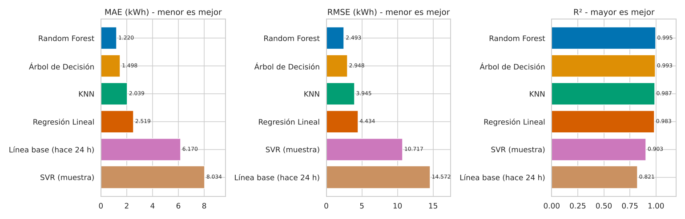

**Real vs predicho (prueba)**
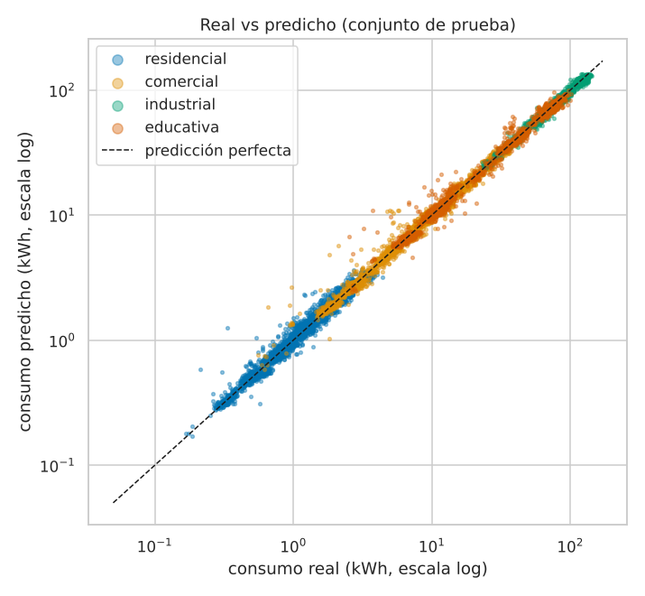

**Importancia de variables**
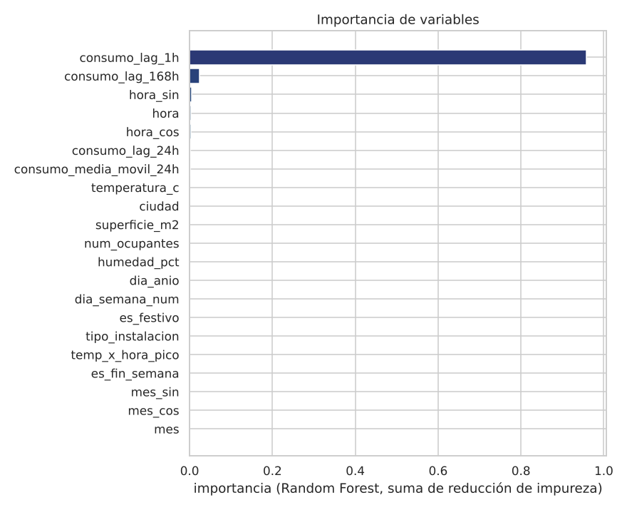

**Residuos**
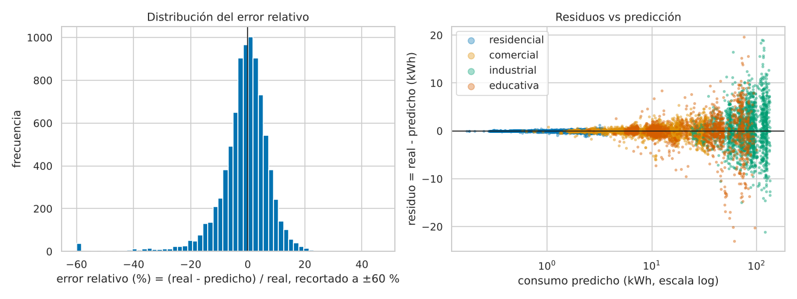

**Series de prueba por instalación (real vs predicho)**
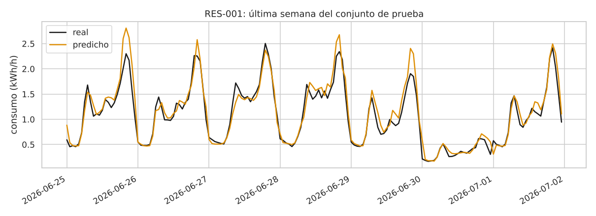
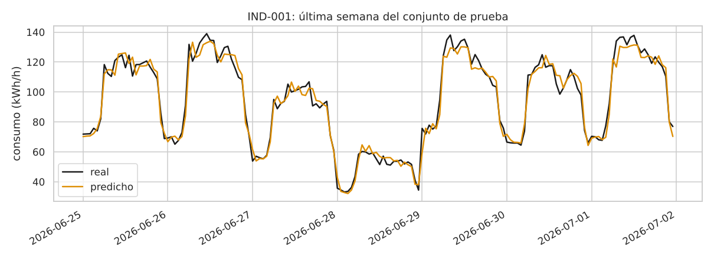
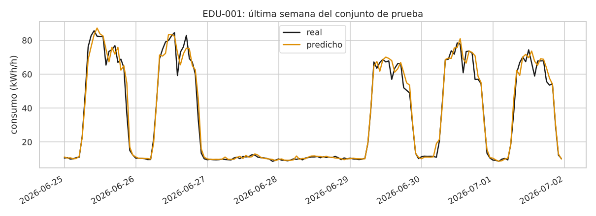

**Análisis exploratorio**
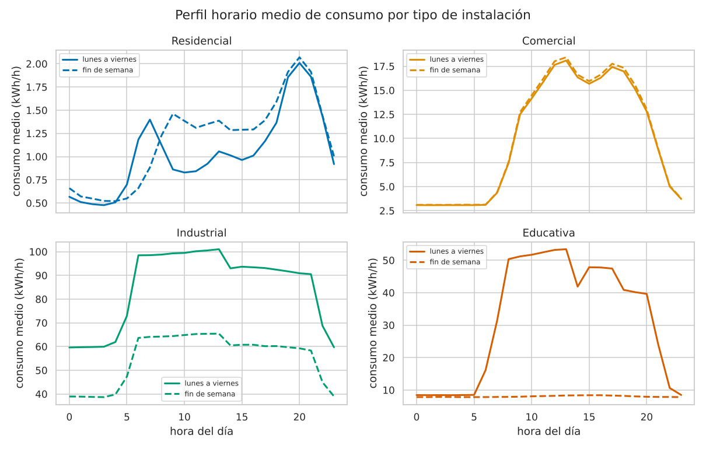
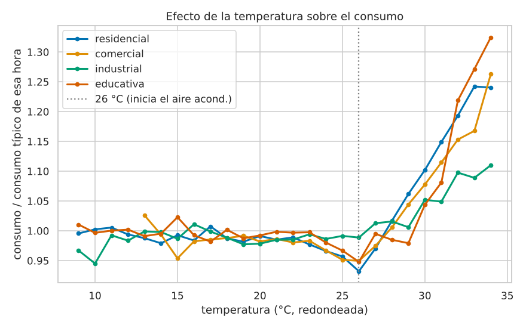
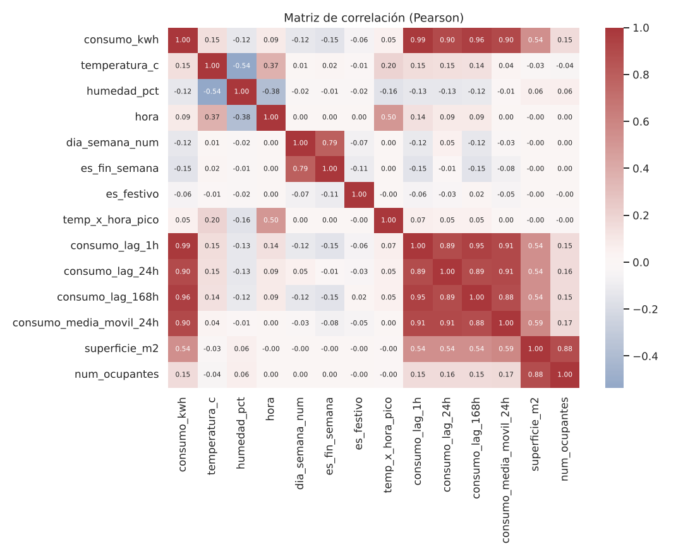

**K-Means**
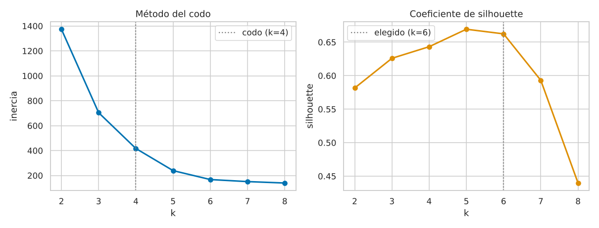
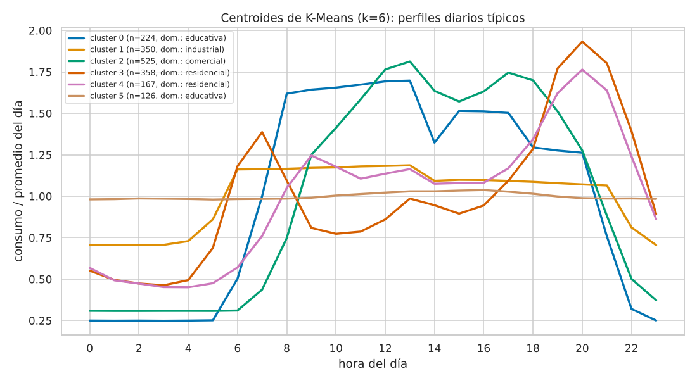

### Cómo reproducir
```bash
python -m src.data.generar_datos
python -m src.data.preparar_datos
python -m src.ml.entrenar_modelo
python -m src.ml.clustering
python -m src.ml.predecir      # ejemplo de predicción
```

### Uso del modelo (API `src/ml/predecir.py`)
```python
from src.ml.predecir import predecir_consumo, pronostico_24h
predecir_consumo("RES-001", "2026-06-20 20:00:00", 31.5, 75)
# -> {"id_instalacion", "fecha_hora", "prediccion_kwh", "intervalo": [lo, hi], "modelo", "entradas": {...}}
pronostico_24h("COM-001", "2026-06-20", temperaturas=None)   # 24 predicciones horarias
```
Para fechas sin histórico, los lags se toman del último valor de la misma hora (y mismo día de la semana para el lag de 168 h) y, en su defecto, del promedio de la instalación a esa hora.
