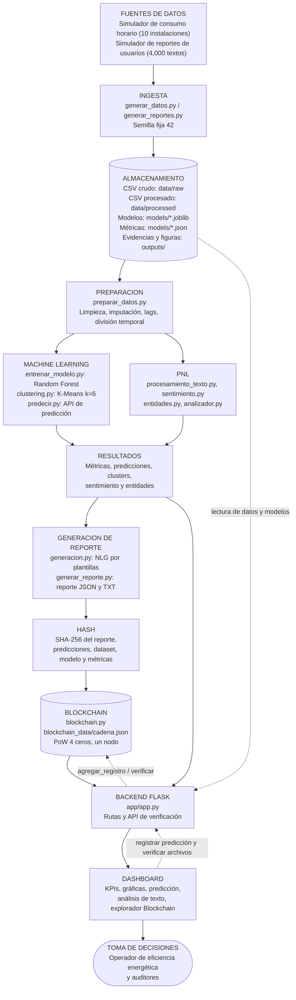

# Arquitectura del sistema SIAPE

Este documento describe el flujo completo de información, desde las fuentes de datos hasta la toma de decisiones. Cumple las secciones 9 y 14 del documento del profesor.

> Nota de coherencia: las partes de datos, ML, PNL y Blockchain están implementadas y ejecutadas (evidencias en `outputs/evidencias/`). El reporte automático (`src/reporte/generar_reporte.py`), el orquestador (`pipeline.py`) y el dashboard (`app/app.py`) se describen según el diseño del proyecto y el código disponible al redactar este documento; los nombres de rutas de Flask deben contrastarse con `app/app.py` al entregar.

## 1. Diagrama del flujo (Mermaid)



## 2. Diagrama del flujo (ASCII)

```
        PROBLEMA: gestionar y verificar el consumo eléctrico de 10 instalaciones
                                   |
                    +--------------+----------------+
                    |                               |
           Consumo horario simulado        Reportes de usuarios simulados
           (generar_datos.py)              (generar_reportes.py)
                    |                               |
                    +--------------+----------------+
                                   v
                           FUENTES DE DATOS
                                   |
                                   v
                    INGESTA (scripts Python, semilla 42)
                                   |
                                   v
        ALMACENAMIENTO: data/raw (CSV) -> data/processed (CSV)
                        models (joblib + JSON)  outputs (figuras, evidencias)
                                   |
                                   v
                 PREPARACIÓN (preparar_datos.py / procesamiento_texto.py)
                                   |
                  +----------------+-----------------+
                  v                                  v
          MACHINE LEARNING                           PNL
   Random Forest (consumo kWh)            sentimiento (SVM lineal + TF-IDF)
   K-Means (perfiles diarios)             NER híbrido (diccionarios + regex)
   predecir.py (API)                      analizador.py
                  |                                  |
                  +----------------+-----------------+
                                   v
                              RESULTADOS
                                   |
                                   v
                    GENERACIÓN DE REPORTE (NLG por plantillas)
                       reporte_<fecha>.json / .txt
                                   |
                                   v
                          HASH (SHA-256)
                                   |
                                   v
              BLOCKCHAIN privada (blockchain_data/cadena.json)
              bloque = indice | marca_tiempo | datos | hash_anterior | nonce | hash
                                   |
                                   v
                 BACKEND Flask (app/app.py)  <--->  VERIFICACIÓN
                                   |
                                   v
                              DASHBOARD
                                   |
                                   v
                        TOMA DE DECISIONES
```

## 3. Qué ocurre en cada etapa

| Etapa | Qué ocurre | Entradas | Salidas | Archivos |
|---|---|---|---|---|
| **Fuentes de datos** | No hay datos reales; se simulan dos fuentes: consumo horario por instalación (clima de Veracruz, perfiles por tipo, ruido, problemas de calidad) y reportes de usuarios (plantillas combinatorias) | Parámetros de `config.py` (instalaciones, periodo, semilla) | Conjuntos "crudos" | `src/data/generar_datos.py`, `src/data/generar_reportes.py` |
| **Ingesta** | Ejecución de los generadores, que escriben los CSV crudos y dejan evidencia con los conteos de problemas inyectados | `config.py` | `consumo_energetico_raw.csv` (44,117 filas), `reportes_usuarios_raw.csv` (4,000) | `generacion_datos.txt`, `generacion_reportes.txt` |
| **Almacenamiento** | CSV para datos, joblib para modelos entrenados, JSON para métricas y resúmenes, PNG para figuras, TXT para evidencias y JSON para la cadena | Salidas de cada etapa | Estructura `data/`, `models/`, `outputs/`, `blockchain_data/` | `config.py` define todas las rutas |
| **Preparación** | Normaliza texto, elimina 437 duplicados, convierte 257 atípicos en nulos, interpola nulos, crea variables (calendario, cíclicas, lags, media móvil) y divide en el tiempo (33,260 entrenamiento / 8,740 prueba) | CSV crudo | `consumo_energetico_procesado.csv` (42,000 filas, 27 columnas) | `src/data/preparar_datos.py`, `preparacion_datos.txt` |
| **ML** | Compara 5 modelos y una línea base con validación cruzada temporal; guarda el Random Forest (R² 0.9948); agrupa perfiles diarios con K-Means (k = 6, silhouette 0.662); ofrece `predecir_consumo()` y `pronostico_24h()` | CSV procesado | `modelo_consumo.joblib`, `metricas_modelos.json`, `kmeans_perfiles.joblib`, `clusters_resumen.json`, `predicciones_test.csv`, figuras | `src/ml/entrenar_modelo.py`, `clustering.py`, `predecir.py` |
| **PNL** | Preprocesa (normalización, tokenización, stopwords, stemming, lematización), clasifica sentimiento con TF-IDF + SVM lineal (F1-macro 0.938), extrae 10 tipos de entidades (NER híbrido) y guarda el resultado por reporte | Reportes crudos | `modelo_sentimiento.joblib`, `metricas_pnl.json`, `reportes_procesados.csv`, `pnl_ejemplos.txt` | `src/nlp/procesamiento_texto.py`, `sentimiento.py`, `entidades.py`, `analizador.py` |
| **Resultados** | Se consolidan métricas, predicciones, clusters, distribución de sentimiento, entidades y dispositivos más mencionados | Salidas de ML y PNL | Diccionario de datos para el reporte y el dashboard | `src/reporte/generar_reporte.py` |
| **Generación de reporte** | La NLG por plantillas redacta un reporte en español con reglas condicionadas (califica R², alerta si hay más de 40 % de reportes negativos, recomienda acciones según los equipos mencionados) | Resultados | `outputs/reportes/reporte_<AAAAMMDD_HHMMSS>.json` y `.txt` | `src/nlp/generacion.py`, `src/reporte/generar_reporte.py` |
| **Hash** | SHA-256 del archivo del reporte, y también del dataset procesado, modelo y métricas; para predicciones, SHA-256 del JSON canónico | Archivos o contenidos | Cadena de 64 caracteres hexadecimales | `sha256_archivo`, `sha256_json` en `src/blockchain/blockchain.py` |
| **Blockchain** | Se crea un bloque con `tipo, nombre, hash_documento, metadatos`, se enlaza con el anterior y se mina (PoW, 4 ceros); se guarda en JSON de forma atómica | Hash y metadatos | Bloque en `blockchain_data/cadena.json` | `src/blockchain/blockchain.py`, `demo_alteracion.py` |
| **Backend Flask** | Sirve las páginas, ejecuta predicciones, analiza texto libre, registra predicciones en la cadena, valida la cadena y verifica archivos o texto subidos | Peticiones HTTP, archivos de `models/`, `data/`, `outputs/` y la cadena | HTML y JSON | `app/app.py` |
| **Dashboard** | Muestra KPIs (registros, instalaciones, consumo, R², sentimiento), gráficas, resultados del modelo, clusters, predicción con intervalo, PNL con entidades resaltadas, explorador de bloques y verificación | Respuestas del backend | Interfaz web local (http://127.0.0.1:5000) | `app/templates/`, `app/static/` |
| **Toma de decisiones** | El operador usa el pronóstico y el reporte (planeación de capacidad, mantenimiento, ahorro) y un auditor verifica su integridad | Dashboard | Acciones; verificación ÍNTEGRO / MODIFICADO | - |

## 4. Tabla de módulos (archivo a responsabilidad)

| Archivo | Responsabilidad |
|---|---|
| `config.py` | Rutas, semilla, periodo simulado, instalaciones, dispositivos, organizaciones y dificultad PoW |
| `src/data/generar_datos.py` | Simula consumo horario con clima, perfiles por tipo y problemas de calidad inyectados |
| `src/data/generar_reportes.py` | Genera 4,000 reportes por plantillas con `entidades_esperadas` |
| `src/data/preparar_datos.py` | `preparar_consumo()`: limpieza, imputación, variables, división temporal; `agregar_variables_calendario()` |
| `src/ml/entrenar_modelo.py` | Entrena y compara modelos, selecciona por `rmse_cv`, guarda modelo, métricas y figuras |
| `src/ml/clustering.py` | K-Means de perfiles diarios; elección de k; días atípicos |
| `src/ml/predecir.py` | `predecir_consumo()` y `pronostico_24h()` con intervalo (percentiles de los árboles) |
| `src/nlp/procesamiento_texto.py` | `preprocesar()`: normalización, tokenización, stopwords, stemming y lematización |
| `src/nlp/sentimiento.py` | TF-IDF + clasificadores; `predecir_sentimiento()` |
| `src/nlp/entidades.py` | `extraer_entidades()` (NER híbrido) y `evaluar_ner()` |
| `src/nlp/generacion.py` | `generar_resumen()` y `resumir_reportes()` (NLG por plantillas) |
| `src/nlp/analizador.py` | `analizar_texto()` y `procesar_reportes()` |
| `src/blockchain/blockchain.py` | Clases `Bloque` y `Blockchain`; funciones SHA-256 |
| `src/blockchain/demo_alteracion.py` | Prueba reproducible de detección de alteraciones |
| `src/reporte/generar_reporte.py` | `generar_reporte()`: reporte JSON y TXT, hash y registro en la cadena |
| `pipeline.py` | Orquesta el flujo completo (`--todo`, `--datos`, `--ml`, `--pnl`, `--reporte`, `--blockchain-demo`) |
| `app/app.py`, `app/templates/` | Dashboard Flask |
| `tests/test_blockchain.py` | Pruebas unitarias de la cadena |

## 5. Flujo de una predicción desde el dashboard

1. **Entrada.** El usuario abre la página *Predicción* (`/prediccion`) y captura instalación (p. ej. RES-001), fecha y hora, temperatura y humedad (y si es festivo).
2. **Validación.** `predecir_consumo()` valida el identificador de instalación (`_validar_id`) y el backend captura los errores de datos inválidos y los muestra como aviso.
3. **Construcción de variables.** `predecir_consumo()` arma la fila: datos de la instalación (`tipo`, `ciudad`, `superficie_m2`, `num_ocupantes`), `agregar_variables_calendario()` (hora, seno/coseno, etc.) y los lags (`consumo_lag_1h`, `_24h`, `_168h`, media móvil) tomados del histórico procesado o, si la fecha es futura, de la misma hora del último día disponible.
4. **Inferencia.** El Pipeline cargado de `models/modelo_consumo.joblib` (StandardScaler + OneHot + Random Forest de 180 árboles) calcula la predicción en kWh. El intervalo es el rango entre los percentiles 5 y 95 de las predicciones de los árboles (cobertura empírica 77.7 %).
5. **Resultado.** El dashboard muestra la predicción, el intervalo y el modelo usado, junto con las entradas empleadas.
6. **Registro opcional.** Con el botón "Registrar en Blockchain" (`POST /api/registrar_prediccion`), el backend **recalcula la predicción en el servidor** (no confía en lo que envía el navegador), calcula `sha256_json(prediccion)` (JSON canónico), crea un bloque de tipo `prediccion` con el nombre `prediccion_<id_instalacion>_<fecha_hora>` y lo guarda en la cadena. Se muestra el índice del bloque y su hash.
7. **Verificación posterior.** En la página *Blockchain* (`/blockchain`, con `/blockchain/verificar` y `/blockchain/validar`) se puede pegar el JSON de la predicción o subir un archivo; el sistema recalcula el hash y responde ÍNTEGRO, MODIFICADO o NO REGISTRADO. La opción "Validar cadena" ejecuta `validar_cadena()`. La ruta `/reportes` genera y descarga reportes.
8. **Decisión.** El operador usa la predicción (por ejemplo, planear la demanda de la hora) con la garantía de que el valor registrado no fue alterado.

```
Formulario -> /prediccion -> predecir_consumo() -> Random Forest -> kWh + intervalo
   -> pantalla -> [Registrar] -> sha256_json -> bloque "prediccion" (PoW) -> cadena.json
   -> [Verificar] -> nuevo hash -> comparar -> ÍNTEGRO / MODIFICADO
```

## 6. Flujo del reporte automático (para la verificación)

1. `generar_reporte()` reúne cifras de los datos procesados, métricas, clusters, resumen de PNL y el pronóstico de 24 h de dos instalaciones representativas (RES-001 e IND-001).
2. La NLG redacta `texto_nlg`.
3. Se escriben `outputs/reportes/reporte_<AAAAMMDD_HHMMSS>.json` y `.txt`.
4. Se calcula el SHA-256 del `.json` tal como quedó en disco y se registra un bloque de tipo `reporte` con metadatos (modelo, R², número de registros, archivo `.txt`).
5. Se valida la cadena y se escribe la evidencia `outputs/evidencias/reporte_registro.txt`.
6. Para verificar, se sube el `.json` en la página *Blockchain*: si se cambió un carácter, el resultado es MODIFICADO.

## 7. Decisiones de diseño

| Decisión | Motivo |
|---|---|
| Solo scikit-learn, pandas, numpy, Flask y biblioteca estándar | Entorno sin red ni NLTK/spaCy; reproducible y explicable |
| `Pipeline` con escalado y OneHot dentro | Evita fuga de información del conjunto de prueba |
| División temporal y lags solo con pasado | Simula el uso real (predecir el futuro) |
| NLG por plantillas y no un LLM | Determinista: el mismo dato produce el mismo texto y por tanto un hash estable |
| Registrar hash y no documento | Privacidad, tamaño y verificación suficiente |
| Blockchain en JSON de un nodo | Prototipo académico explicable; no requiere infraestructura |
| Dashboard Flask local | Cumple el requisito de interfaz sin despliegue en la nube |
